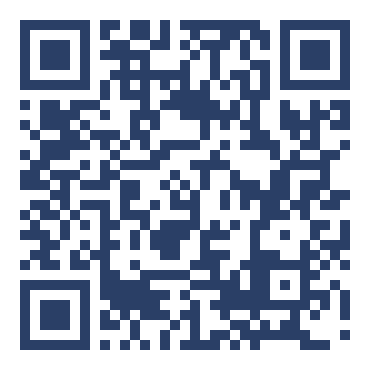

## Alles zum Mitlesen {.bp-plain}

::: {.bp-zwei}

::: {}
[Alles, was heute kommt, steht dauerhaft online.]{.bp-eyebrow}

[****]{.bp-url}

::: {.bp-icons}
::: {}
[]{.bp-icon}
kostenfrei
:::
::: {}
[]{.bp-icon}
ohne Anmeldung
:::
::: {}
[]{.bp-icon}
im Browser
:::
:::

Der QR oben rechts wandert mit. Er zeigt immer dorthin, wo du das Gezeigte
nachliest.
:::

::: {.bp-qr .bp-qr--gross}

[Der Hub, Startseite]{.bp-qr__cap}
:::

:::

::: notes
**Typ** Wegweiser · **Soll** 00:30 · **Dauer** 0:45 · kürzbar: nein

**Woher** Titel und Begrüßung sind vorbei. Bevor irgendein Inhalt kommt, nimmt
diese Folie den Druck raus, mitschreiben zu müssen.

**Hier** „Du musst dir heute nichts notieren. Alles steht online, und der QR
oben rechts zeigt immer auf die passende Stelle."
Die Adresse einmal laut lesen. Auf den QR oben rechts zeigen und sagen, dass er
mitwandert. Die drei Symbole nicht erklären, sie erklären sich selbst.

**Wohin** In den Einstieg des jeweiligen Decks: im Überblick das Quiz, in den
Workshops die Standortfolie. Übergang im Überblick: „Und weil ihr nichts
mitschreiben müsst, habt ihr die Hände frei. Die brauchen wir gleich."

**Wenn** Jemand scannt sofort und die Seite lädt nicht: das ist das WLAN, nicht
die Seite. Kurz sagen, dass alles auch später zu Hause geht, und weitermachen.
:::
