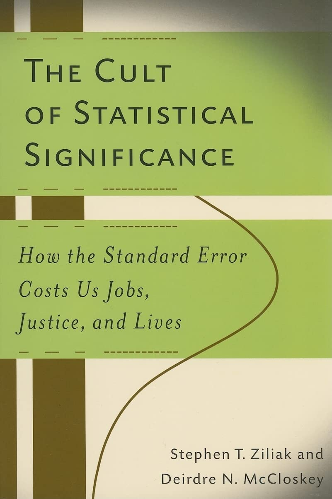

## Die Folgekette {data-qr="hub_pwerte" data-qr-cap="Warum das wichtig ist"}

::: {.bp-fig}

:::

::: {.bp-warn}
[]{.bp-icon} Simmons et al. (2011): aus nominal
**5 %** werden bis zu **61 %** falsch-positive Befunde.
:::

::: notes
**Typ** Abbildung · **Soll** 11:30 · **Dauer** 1:30 · kürzbar: nein

**Woher** Die vier Zahlen stehen. Jetzt, wie sie zusammenhängen: als Kreislauf,
nicht als Liste.

**Hier** „Jeder dieser drei Schritte funktioniert vollständig ohne böse Absicht.
Das ist das eigentlich Beunruhigende."
Den Kreis einmal im Uhrzeigersinn abgehen, mit der Hand auf der Folie:
Signifikantes wird bevorzugt publiziert, das belohnt fragwürdige Praktiken
(p-Hacking, optionales Weitertesten, selektives Reporting), die erzeugen
Fehlbefunde, Replikationen scheitern, und weil Nullbefunde nicht erscheinen,
bleibt der Kreislauf unsichtbar. Dann die Mitte: alles ohne Vorsatz.

**Wohin** Die nächste Folie zeigt den Preis außerhalb der Journals. Übergang:
„Und das bleibt nicht in den Zeitschriften."

**Wenn** Nachfrage nach HARKing: Hypothesizing After the Results are Known, die
Hypothese nachträglich ans Ergebnis anpassen. Keine Betrugsvorwürfe, auch nicht
auf Nachfrage: der Punkt ist, dass gute Absicht nicht schützt.
:::

## Und das bleibt nicht im Journal {data-qr="hub_literatur" data-qr-cap="Schlüsselliteratur"}

::: {.bp-zwei}

::: {.bp-cover}

:::

::: {}
::: {.bp-quote}
The Cult of Statistical Significance: How the Standard Error Costs Us Jobs,
Justice, and Lives.
:::
[Ziliak und McCloskey, 2008]{.bp-quote__author}

::: {.bp-quote .bp-quote--klein}
… too often I suspect we waste a [great] deal of time, we grasp the shadow and
lose the substance, we weaken our capacity to interpret data and to take
reasonable decisions whatever the value of P. And far too often we deduce
‘no difference' from ‘no significant difference'.
:::
[Austin Bradford Hill, 1965]{.bp-quote__author}
:::

:::

::: notes
**Typ** Aha · **Soll** 13:00 · **Dauer** 0:45 · kürzbar: ja

**Woher** Der Kreislauf ist erklärt. Diese Folie ist der Tiefpunkt des Vortrags,
und zwar absichtlich. Danach dreht es.

**Hier** „Therapien, Maßnahmen und politische Entscheidungen stützen sich auf
signifikante Ergebnisse, die Zufallsbefunde sind oder praktisch irrelevant
klein."
Den Buchtitel vorlesen, dann eine Sekunde schweigen, besonders nach „Jobs,
Justice, and Lives". Hill danach nur mit dem letzten Satz: aus „nicht
signifikant" wird „kein Unterschied". Hill ist der Epidemiologe der
Bradford-Hill-Kriterien, 1965, also sechzig Jahre alt.

**Wohin** Die nächste Folie zeigt, dass das keine Einzelmeinung ist. Übergang:
„Und Hill war nicht allein."

**Wenn** Kein Humor auf dieser Folie. Zeitdruck: Folie überspringen, der
Meehl-Satz auf der nächsten reicht. (persönlich: wer ein eigenes Beispiel aus
dem Gesundheitsbereich hat, bringt es hier, es trifft direkter.)
:::

## Seit sechzig Jahren gesagt {data-qr="hub_literatur" data-qr-cap="Schlüsselliteratur"}

::: {.bp-quote}
… one of the worst things that ever happened in the history of psychology.
:::
[Paul Meehl über den Signifikanztest, 1978]{.bp-quote__author}

::: {.bp-liste .bp-liste--zwei}
- Rozeboom (1960). The Fallacy of the Null-Hypothesis Significance Test.
- Carver (1978). The Case Against Statistical Significance Testing.
- Salsburg (1985). The Religion of Statistics as Practiced in Medical Journals.
- Cohen (1994). The Earth Is Round (p < .05).
- Falk & Greenbaum (1995). Significance Tests Die Hard.
- Hunter (1997). Needed: A Ban on the Significance Test.
- Moran & Solomon (2004). A Farewell to P-Values?
- Gigerenzer (2004). Mindless Statistics.
- Goodman (2008). A Dirty Dozen: Twelve P-Value Misconceptions.
- Stang, Poole & Kuss (2010). The Ongoing Tyranny of Statistical Significance Testing.
:::

::: {.bp-quelle}
Kleine Auswahl aus einer langen Liste.
:::

::: notes
**Typ** Aha · **Soll** 13:45 · **Dauer** 0:45 · kürzbar: ja

**Woher** Hill 1965 war der Anfang. Diese Folie zeigt, dass die Kritik seit
sechzig Jahren in den besten Zeitschriften steht und nichts geändert hat.

**Hier** „Das ist eine kleine Auswahl. Rozeboom 1960, Cohen 1994, Gigerenzer
2004, Goodman 2008. Alle sagen dasselbe, und das Ritual läuft weiter."
Die Liste nicht vorlesen. Zwei oder drei Titel herausgreifen, die Jahreszahlen
betonen: sechs Jahrzehnte. Meehl oben ist der stärkste Satz: kein Aktivist von
heute, sondern einer der einflussreichsten Methodiker der Psychologie.

**Wohin** Die Selbstprüfung: vom System zur eigenen Arbeit. Übergang: „Wir
wissen das seit Jahrzehnten. Und trotzdem."

**Wenn** Zeitdruck: Folie überspringen. Nachfrage nach der vollständigen Liste:
der QR oben rechts führt zur Literaturseite im Hub.
:::
