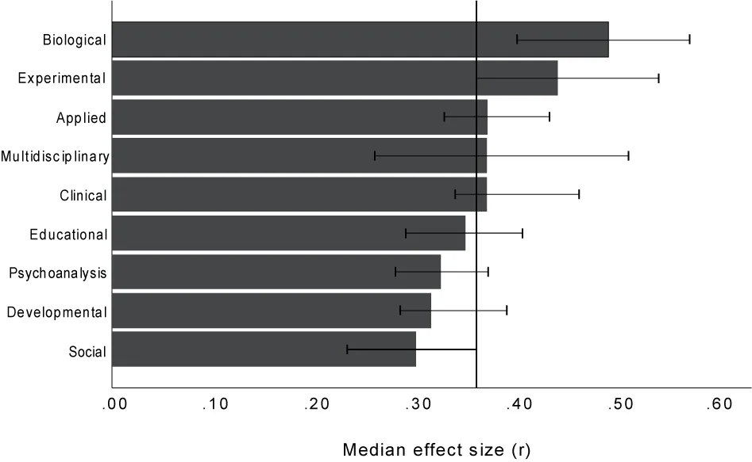

## Antwort 01: Effekte berichten {data-qr="hub_effektgroessen" data-qr-cap="Effekte und Effektgrößen"}

::: {.bp-stats}
::: {.bp-stat}
[4,2 Punkte]{.bp-stat__num}
[**Unstandardisiert**, in der Einheit der Sache: die Therapie senkt den BDI-II
um 4,2 Punkte. Die Praxis versteht das sofort.]{.bp-stat__label}
:::
::: {.bp-stat}
[d = 0.42]{.bp-stat__num}
[**Standardisiert**, immer mit Intervall: 95 % CI [0.18, 0.66]. Vergleichbar
über Studien und Skalen hinweg.]{.bp-stat__label}
:::
:::

::: {.bp-quote}
The primary product of a research inquiry is one or more measures of effect
size, not p values.
:::
[Jacob Cohen, 1990]{.bp-quote__author}

::: notes
**Typ** Aha · **Soll** 20:00 · **Dauer** 1:45 · kürzbar: nein

**Woher** Frage 01 ist gestellt: gibt es einen Effekt, und wie groß? Die Antwort
sind zwei Zahlen, in dieser Reihenfolge.

**Hier** „Erst die Zahl in der Einheit der Sache. Dann die Zahl, die man
vergleichen kann. Und nie ohne Intervall."
Links zuerst: 4,2 Punkte. Der Satz funktioniert, weil jeder sofort fragt, ob
das viel ist. Genau diese Frage ist die richtige, und bei p ist sie nicht
möglich. Dann rechts: d = 0.42 mit Intervall. Ein Punktschätzer ohne Intervall
ist eine Behauptung ohne Fehlerangabe.

**Wohin** Die Faustregel-Folie, damit das neue Ritual nicht das alte ersetzt.
Übergang: „Und jetzt fragt ihr: ist 0.42 viel? Vorsicht."

**Wenn** Zeitdruck: Cohen-Zitat nicht vorlesen, es steht da. Nachfrage, warum
nicht nur d: weil d die Einheit verliert, und mit ihr die
Entscheidungsgrundlage. Deshalb beides.
:::

## Aber Vorsicht mit den Faustregeln {data-qr="hub_effektgroessen" data-qr-cap="Benchmarks im Kontext"}

Cohen 1988 für r: **klein .10 · mittel .30 · groß .50.** Als Notlösung gedacht.

::: {.bp-fig .bp-fig--klein}

:::

::: {.bp-warn}
[]{.bp-icon} **Domänenwissen schlägt Faustregel.**
r = .30 ist in der Sozialpsychologie typisch, in der biologischen Psychologie
klein.
:::

::: {.bp-quelle}
Median der publizierten Effektstärken (r) je Teildisziplin, Linie: Gesamtmedian.
Schäfer & Schwarz (2019), Frontiers in Psychology.
:::

::: notes
**Typ** Abbildung · **Soll** 21:45 · **Dauer** 1:15 · kürzbar: ja · **Wer** Thomas

**Woher** Wer gerade gelernt hat, d zu berichten, ersetzt sonst nur ein Ritual
durch ein anderes: statt „p kleiner .05" dann „mittlerer Effekt nach Cohen".
Hier übernimmt Thomas, es ist seine Studie.

**Hier** „Vergleiche deinen Effekt mit deinem Feld, nicht mit Cohens
Faustregel."
Die Grafik von oben nach unten: biologische Psychologie Median .49,
Sozialpsychologie .30, Gesamtmedian .36. Ein r von .30 ist in der einen
Disziplin unterdurchschnittlich, in der anderen typisch. Cohen hat seine Werte
selbst als Notlösung bezeichnet, für Felder ohne eigene Vergleichswerte. Die
gibt es jetzt.

**Wohin** Antwort 02, die Stichprobe. Übergang: „Die Zahl ist das eine. Ob sie
überhaupt trägt, das andere."

**Wenn** Nachfrage nach der Datenbasis: publizierte Effekte, getrennt nach
präregistriert und nicht präregistriert, die präregistrierten liegen deutlich
niedriger. Das ist zugleich das Publikationsbias-Argument von vorhin mit Daten.
Zeitdruck: Folie überspringen, der Hinweis steht in „Morgen anders" als Punkt 4.
:::
